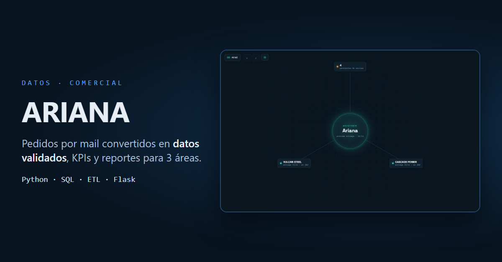
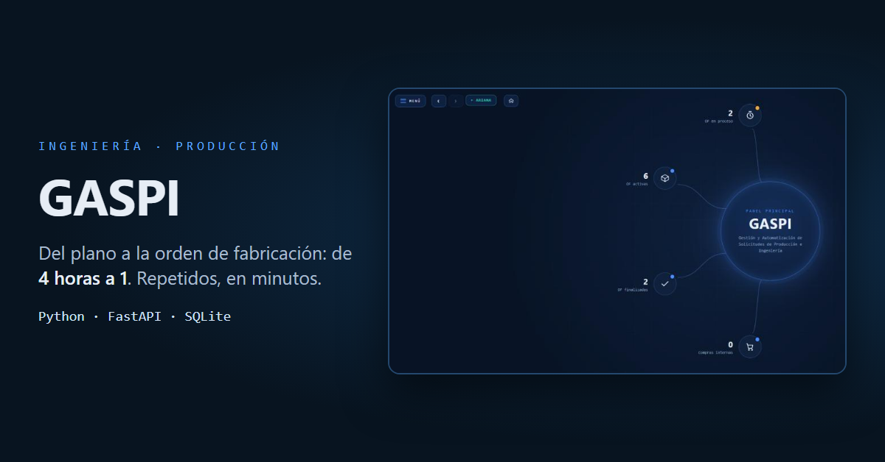

## Hola, soy Theo 👋

Estudiante avanzado de **Ingeniería Industrial** (UNSAM) y Técnico Electromecánico.
Trabajo en la oficina técnica de una empresa industrial, donde construyo sistemas de
datos y automatización que hoy están **en producción** y usan varias áreas todos los días.

Me interesa el punto donde se cruzan el proceso y los datos: entender cómo funciona
algo en planta, medirlo y armar la herramienta que lo hace más simple.

📍 Buenos Aires · Abierto a oportunidades en **Datos, Control de Gestión, Mejora de Procesos y Operaciones**

---

### Proyectos

**[ARIANA](https://github.com/DifalcoTheo/ARIANA)**: los pedidos que llegaban por mail se convierten en datos validados en SQL,
con KPIs y reportes para Comercial, Ingeniería y Producción. Incluye validación humana y unificación de clientes duplicados.
`Python` `Flask` `SQLite` `ETL`

**[GASPI](https://github.com/DifalcoTheo/GASPI)**: del plano técnico (PDF) a la orden de fabricación calculada. Bajó el armado
de una orden de **4 horas a 1** (minutos si el producto es repetido), y cada cálculo muestra de qué fórmula sale.
`Python` `FastAPI` `SQLite` `PyMuPDF`

> Los dos tienen una **demo con datos ficticios**. En Windows: *Code → Download ZIP* → doble clic en `DEMO.bat`.

---

### Con qué trabajo

`Python` · `SQL` · `Excel / VBA` · `ETL` · `Flask` · `FastAPI` · `Git` · `IA aplicada (Claude, ChatGPT)` · `Power BI (en formación)`

### Cómo trabajo

- **La herramienta propone, una persona valida.** En mis dos sistemas nada se da por bueno sin revisión.
- **Primero la calidad del dato.** Un reporte prolijo sobre datos sucios no informa, engaña.
- **Simple y hecho por quien conoce el problema.** Prefiero resolver hoy algo concreto que esperar la solución grande.

### Contacto

[LinkedIn](https://www.linkedin.com/in/difalcotheo) · difalcotheo@gmail.com

---

🇬🇧 Advanced Industrial Engineering student (UNSAM) building data and automation systems that run in production at an industrial company. Python · SQL. Open to data, operations and process-improvement roles in Buenos Aires.
